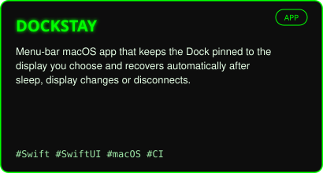
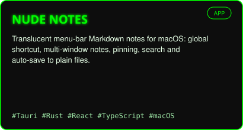
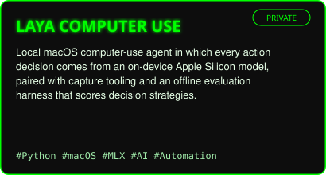
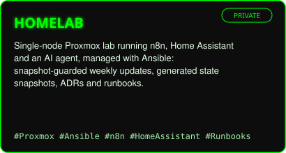

<a href="https://williamnunes.com">
<picture>
  <source media="(prefers-reduced-motion: reduce) and (prefers-color-scheme: light) and (max-width: 600px)" srcset="assets/hero/hero-mobile-light-static.svg">
  <source media="(prefers-reduced-motion: reduce) and (max-width: 600px)" srcset="assets/hero/hero-mobile-dark-static.svg">
  <source media="(prefers-color-scheme: light) and (max-width: 600px)" srcset="assets/hero/hero-mobile-light.svg">
  <source media="(max-width: 600px)" srcset="assets/hero/hero-mobile-dark.svg">
  <source media="(prefers-reduced-motion: reduce) and (prefers-color-scheme: light)" srcset="assets/hero/hero-light-static.svg">
  <source media="(prefers-reduced-motion: reduce)" srcset="assets/hero/hero-dark-static.svg">
  <source media="(prefers-color-scheme: light)" srcset="assets/hero/hero-light.svg">
  
</picture>
</a>

### `~$ whoami`

**William Nunes** · Workplace Automation Engineer at LI.FI · Berlin

**Where AI agents meet real work.** I turn manual, repetitive operations into software: autonomous agents, automated workflows and the secure foundations they run on. Shipped to production, not left in slides.

→ CV, experience and every project: **[williamnunes.com](https://williamnunes.com)**

### `~$ ls ~/projects`

<table>
  <tr>
    <td width="50%">
      <a href="https://github.com/th30ne-W/DockStay"><picture><source media="(prefers-color-scheme: light)" srcset="assets/cards/dockstay-light.svg"></picture></a>
    </td>
    <td width="50%">
      <a href="https://github.com/th30ne-W/Nude-Notes"><picture><source media="(prefers-color-scheme: light)" srcset="assets/cards/nude-notes-light.svg"></picture></a>
    </td>
  </tr>
  <tr>
    <td width="50%">
      <a href="https://williamnunes.com/projects/"><picture><source media="(prefers-color-scheme: light)" srcset="assets/cards/laya-light.svg"></picture></a>
    </td>
    <td width="50%">
      <a href="https://williamnunes.com/projects/"><picture><source media="(prefers-color-scheme: light)" srcset="assets/cards/homelab-light.svg"></picture></a>
    </td>
  </tr>
</table>

Laya Computer Use and Homelab are private repositories; details on [williamnunes.com/projects](https://williamnunes.com/projects/).

### `~$ cat stack.txt`

<table>
  <tr>
    <td><b>Identity &amp; Access</b></td>
    <td>    </td>
  </tr>
  <tr>
    <td><b>Automation &amp; AI</b></td>
    <td>     </td>
  </tr>
  <tr>
    <td><b>Infrastructure</b></td>
    <td>   </td>
  </tr>
  <tr>
    <td><b>Devices &amp; Workplace IT</b></td>
    <td>    </td>
  </tr>
</table>

### `~$ git log --since="1 year ago"`

<a href="https://github.com/th30ne-W">
<picture>
  <source media="(prefers-reduced-motion: reduce) and (prefers-color-scheme: light) and (max-width: 600px)" srcset="assets/calendar/calendar-mobile-light-static.svg">
  <source media="(prefers-reduced-motion: reduce) and (max-width: 600px)" srcset="assets/calendar/calendar-mobile-dark-static.svg">
  <source media="(prefers-color-scheme: light) and (max-width: 600px)" srcset="assets/calendar/calendar-mobile-light.svg">
  <source media="(max-width: 600px)" srcset="assets/calendar/calendar-mobile-dark.svg">
  <source media="(prefers-reduced-motion: reduce) and (prefers-color-scheme: light)" srcset="assets/calendar/calendar-light-static.svg">
  <source media="(prefers-reduced-motion: reduce)" srcset="assets/calendar/calendar-dark-static.svg">
  <source media="(prefers-color-scheme: light)" srcset="assets/calendar/calendar-light.svg">
  
</picture>
</a>

Each square is a day; the brighter it is, the more I shipped. Most of my work lives in private repositories, so the calendar counts it without exposing names. A GitHub Action in this repo redraws it every day.

### `~$ ping william`

[williamnunes.com](https://williamnunes.com) · [LinkedIn](https://www.linkedin.com/in/william-nunes-a3898b37/)
